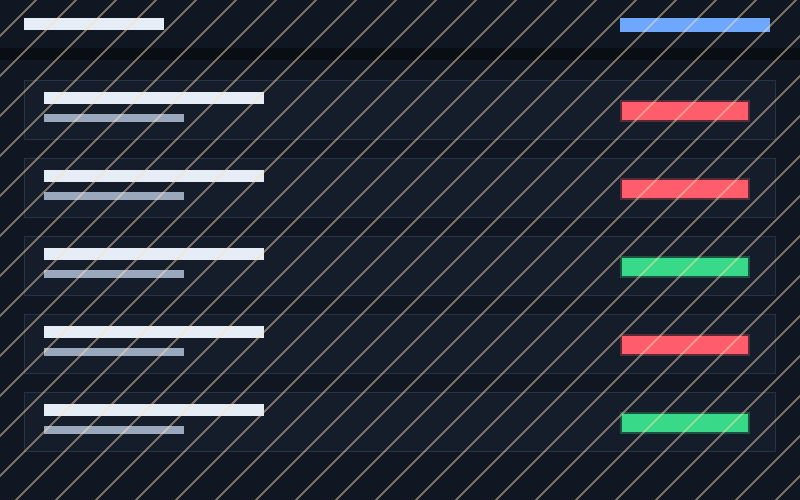
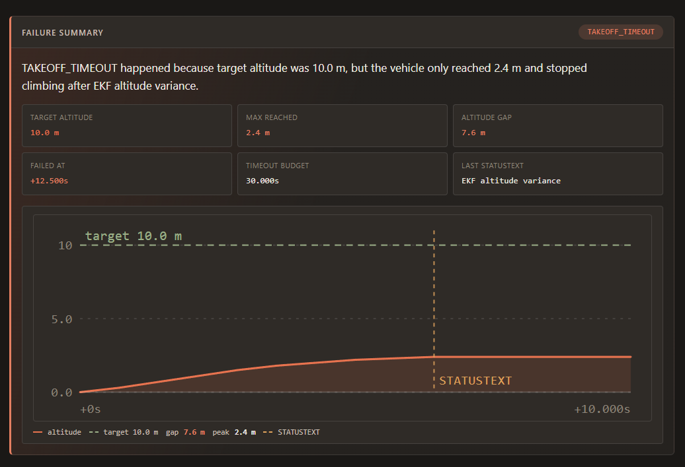
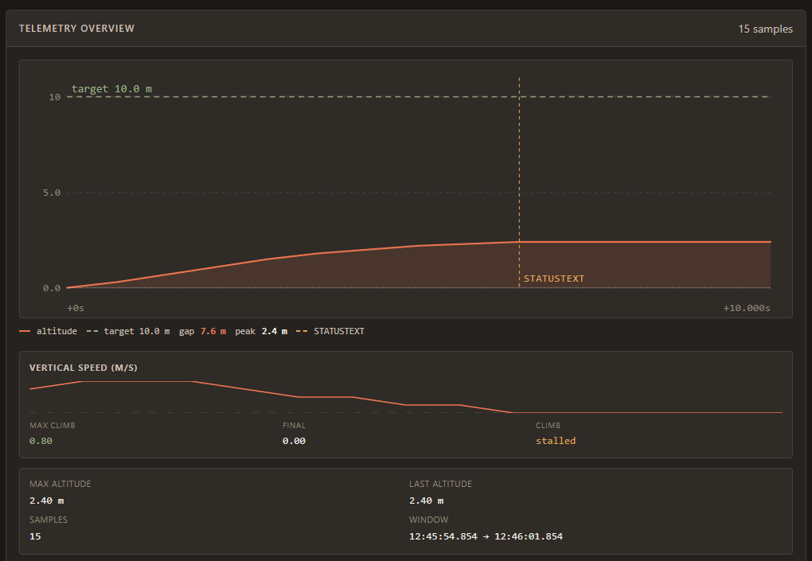
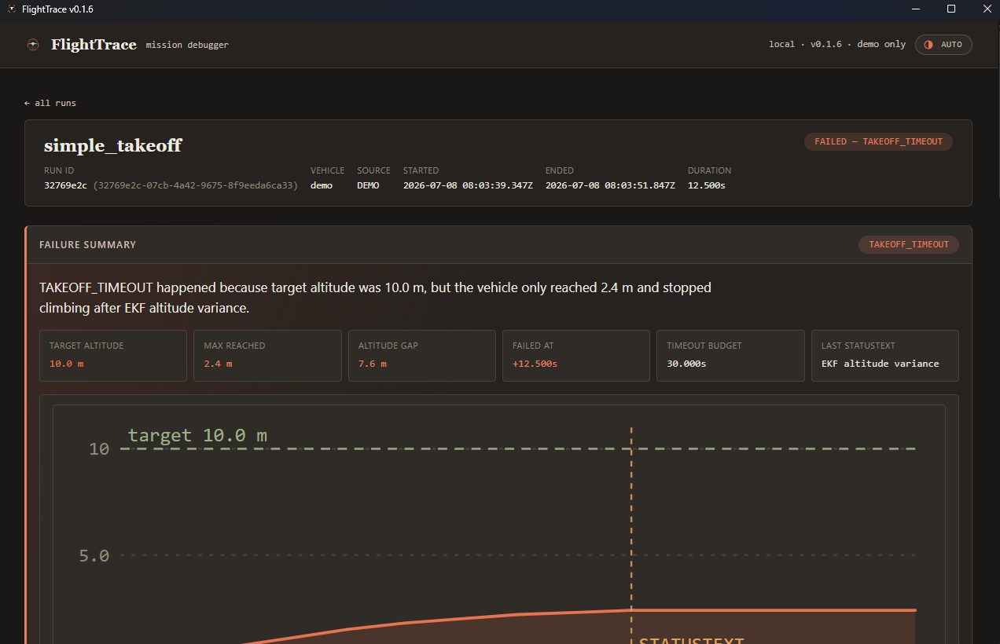

# FlightTrace

[](https://github.com/WiverNz/FlightTrace/actions/workflows/ci.yml)
[](#license)

> **FlightTrace helps PX4/ArduPilot developers understand why
> autonomous missions fail.** Local-first, read-only on the vehicle,
> and ships with a deterministic demo run so you can evaluate it
> without installing PX4 or ArduPilot.

## Screenshots

**Runs list** — failed demo runs with the `TAKEOFF_TIMEOUT` badge.



**Failure summary** — plain-English diagnosis, six fact tiles, and an
altitude chart with the target line and failure marker.



**Telemetry overview** — altitude chart, vertical-speed panel, and run
statistics.



**Desktop shell** — run details in a Tauri v2 native Windows window.



See [`docs/screenshots/README.md`](docs/screenshots/README.md) for the
capture recipe.

## Why FlightTrace?

When an autonomous mission fails, the interesting question is *why*,
not *what happened*. Log viewers show you the bytes; ground stations
show you the plane. Neither one tells you "the vehicle only reached
2.4 m out of a 10 m target and stopped climbing after an EKF altitude
variance warning."

FlightTrace records MAVLink telemetry (or a synthetic demo run),
reconstructs the mission timeline as normalised events, evaluates a
declarative YAML assertion spec against the recording, and emits a
**structured failure report with cited evidence** — locally, on your
machine, in one process.

**What it is not**: not a ground control station (cannot arm, disarm,
change mode, or send commands — read-only, always), not AirData /
Flight Review, not fleet management, not a cloud product, not
multi-user.

## Quick demo

Requires a stable Rust toolchain (`edition = "2024"`, MSRV ≥ 1.85) and
Node.js ≥ 18 with `npm`.

```bash
cd web && npm ci && npm run build && cd ..
cargo run -p flighttrace-cli -- serve \
    --database ./data/flighttrace.db \
    --web-dir ./web/dist \
    --open
```

Then in the browser: click **Create demo failed run** at the top
right, open the new row.

## What you should see

The run detail page renders this sentence at the top:

> **TAKEOFF_TIMEOUT happened because target altitude was 10.0 m, but
> the vehicle only reached 2.4 m and stopped climbing after EKF
> altitude variance.**

...backed by five fact tiles (target / max reached / gap / failure
time / STATUSTEXT), an altitude chart with a dashed target line and a
failure marker, a mission timeline with relative timestamps, an
assertions table, and a raw event log. If that sentence rendered, the
whole pipeline works.

## Run modes

| Mode | Command shape | Best for |
| --- | --- | --- |
| **Downloaded CLI (opens browser)** | Windows: double-click `start-flighttrace.bat` or `.\flighttrace.exe`. Linux: `./flighttrace`. | End users who don't mind the default browser opening. |
| **Downloaded native desktop app** | Windows: install `flighttrace-desktop-<v>-…-setup.exe` (or `.msi`), launch **FlightTrace** from the Start menu. | End users who want a native window, no browser. |
| **Packaged web** | `flighttrace serve --web-dir ./web/dist --open` | Developer packaged evaluation from a checkout. |
| **Desktop (Tauri v2, from source)** | `cd apps/flighttrace-desktop/src-tauri && cargo tauri dev` | Native window during development; see [`docs/desktop.md`](docs/desktop.md). |
| **Dev (two processes)** | `cargo run … serve` + `npm run dev` | Frontend iteration with HMR. |
| **CLI, API-only** | `flighttrace serve` | Backend dev; `curl`-driven. |

**Which asset should I download?**

- **CLI zip / tarball** (`flighttrace-<v>-<target>.zip` / `.tar.gz`) —
  contains `flighttrace` + `web-dist/` + docs. Run the binary; it
  opens your default browser at `http://127.0.0.1:<port>/`. Bring your
  own browser.
- **Native desktop installer** (`flighttrace-desktop-<v>-…-setup.exe`
  or `.msi`, Windows only in v0.1) — installs the same UI in a
  native window driven by Tauri v2. Requires the Microsoft WebView2
  runtime; preinstalled on Windows 11, auto-fetched by the installer
  on Windows 10.

Both flavours use the same backend + React UI + SQLite. Pick whichever
UX you prefer.

**No-arg CLI details.** Running `flighttrace` bare detects `web-dist/`
sitting next to it, binds a random loopback port, prints
`FlightTrace UI: http://127.0.0.1:<port>/`, and opens the browser.
Missing `web-dist/` produces a single-sentence actionable error
instead of a silent no-op. Run `flighttrace --help` for the full
subcommand list; `flighttrace serve` remains the way to get an
API-only or fully-flag-configured server.

Full explanations in [`docs/run-modes.md`](docs/run-modes.md). Every
`serve` flag also reads a matching `FLIGHTTRACE_*` env var — the full
table lives in [`docs/configuration.md`](docs/configuration.md).

The app-header toggle in the top-right cycles between `auto` (follows
your OS preference), `light`, and `dark`. Your choice persists in
`localStorage`. Both themes are warm — parchment/cream in light,
warm charcoal in dark — never cold navy or pure white.

## Read-only guarantee

FlightTrace **never** writes to the MAVLink socket. It does not arm,
disarm, change mode, upload missions, set parameters, or send any
other command. The `flighttrace-mavlink` crate exposes no send
function, and an in-tree integration test
(`crates/flighttrace-mavlink/tests/read_only_invariant.rs`) scans the
crate's source for forbidden send-related APIs on every build. Attach
FlightTrace to a live vehicle as a passive observer.

## How it works

1. **Ingest.** `flighttrace-mavlink` reads MAVLink UDP packets from
   SITL or a real vehicle. The demo source produces the same shape of
   data without a vehicle.
2. **Normalize.** Each MAVLink message becomes a vehicle-agnostic
   `NormalizedEvent` (`ArmedChanged`, `AltitudeUpdated`,
   `TelemetryGapDetected`, …) plus periodic `TelemetrySample`s.
   Everything downstream consumes these — the source is
   interchangeable.
3. **Evaluate.** When a mission run ends (or on demand via the
   re-evaluate API), `flighttrace-assertions` runs the YAML mission
   spec against the recorded events and samples.
4. **Explain.** Failing checks produce a `FailureReport` with the
   reason, cited evidence (events, samples, statustexts), and a
   one-paragraph likely cause.

## Mission assertions

A mission spec is a small YAML file. From
`examples/missions/simple_takeoff.yaml`:

```yaml
mission: simple_takeoff
vehicle: ardupilot_copter
steps:
  - name: connect
    expect:
      heartbeat_within_sec: 5
  - name: arm
    expect:
      armed: true
      within_sec: 5
  - name: takeoff
    expect:
      altitude_at_least_m: 10
      within_sec: 30
      mode_not_changes: true
      no_telemetry_gap_longer_than_sec: 2
```

v0.1 checks: `heartbeat_within_sec`, `armed`, `altitude_at_least_m`,
`mode_not_changes`, `no_telemetry_gap_longer_than_sec`. When any check
fails, the engine emits a `FailureReport` with `summary = "Mission
failed: <REASON>"`, the union of cited evidence, and a likely-cause
string. No scripting, no conditional logic — checks are declarative.

## SITL quickstarts

Short form. See [`docs/sitl.md`](docs/sitl.md) for the full recipe
with three terminals, port-conflict notes, and MAVProxy tips.

**ArduPilot**:

```bash
sim_vehicle.py -v ArduCopter --out=udpout:127.0.0.1:14550
cargo run -p flighttrace-cli -- serve \
    --database ./data/flighttrace.db \
    --web-dir ./web/dist \
    --mavlink udp://127.0.0.1:14550 \
    --mission examples/missions/simple_takeoff.yaml \
    --open
```

**PX4**:

```bash
make px4_sitl gazebo-classic
cargo run -p flighttrace-cli -- serve \
    --database ./data/flighttrace.db \
    --web-dir ./web/dist \
    --mavlink udp://127.0.0.1:14550 \
    --mission examples/missions/simple_takeoff.yaml \
    --open
```

## Development

Quality gates that must stay green:

```bash
cargo fmt --all -- --check
cargo clippy --workspace --all-targets -- -D warnings
cargo test --workspace
cd web && npm run build && npm run lint
cd apps/flighttrace-desktop/src-tauri && cargo check
```

Useful one-offs:

```bash
# Inspect the deterministic demo bundle as JSON.
cargo run -p flighttrace-cli -- demo | head -n 40

# End-to-end smoke against a release build.
cargo build --release -p flighttrace-cli
scripts/release-smoke.sh
```

## Documentation

Focused deep-dives, one per topic:

- [`docs/run-modes.md`](docs/run-modes.md) — packaged web, desktop,
  dev, and API-only.
- [`docs/desktop.md`](docs/desktop.md) — Tauri v2 setup, Linux
  packages, WSL2 rendering fix, resource resolution.
- [`docs/configuration.md`](docs/configuration.md) — env-var table,
  `.env` pattern, VS Code launch profiles.
- [`docs/sitl.md`](docs/sitl.md) — full PX4 and ArduPilot recipes.
- [`docs/api.md`](docs/api.md) — endpoint reference, JSON
  conventions, error envelope, CORS, smoke script.
- [`docs/docker.md`](docs/docker.md) — backend-only, optional image.
- [`docs/troubleshooting.md`](docs/troubleshooting.md) — ports, DB
  locks, MAVLink silence, WSL2, toolchain.

Reference docs live alongside these:

- [`docs/prd.md`](docs/prd.md) — product brief.
- [`docs/context.md`](docs/context.md) — working conventions.
- [`docs/tech-stack.md`](docs/tech-stack.md) — architecture and
  design-system notes.
- [`docs/release-checklist.md`](docs/release-checklist.md) — the
  cut-a-release checklist.
- [`docs/release-notes/v0.1.0.md`](docs/release-notes/v0.1.0.md) —
  the current release note draft.
- [`docs/issues/`](docs/issues/) — per-issue specs and verification
  logs.

## Project layout

```
flighttrace/
  Cargo.toml                       # workspace manifest
  apps/
    flighttrace-desktop/           # Tauri v2 shell (excluded from workspace)
  crates/
    flighttrace-core/              # domain types
    flighttrace-demo/              # deterministic failed-run generator
    flighttrace-storage/           # sqlx + SQLite
    flighttrace-api/               # Axum REST API + static serving
    flighttrace-mavlink/           # read-only MAVLink UDP ingest
    flighttrace-assertions/        # YAML assertion engine + reports
    flighttrace-cli/               # `flighttrace` binary
  web/                             # React + TypeScript + Vite UI
  examples/missions/               # simple_takeoff.yaml
  docs/                            # everything above
  scripts/                         # release-smoke.sh + generators
```

## License

Dual-licensed under [Apache License, Version 2.0](LICENSE-APACHE) or
[MIT License](LICENSE-MIT) at your option. Workspace metadata declares
`license = "MIT OR Apache-2.0"`.

Unless you explicitly state otherwise, any contribution intentionally
submitted for inclusion in the work by you, as defined in the
Apache-2.0 license, shall be dual licensed as above, without any
additional terms or conditions.
